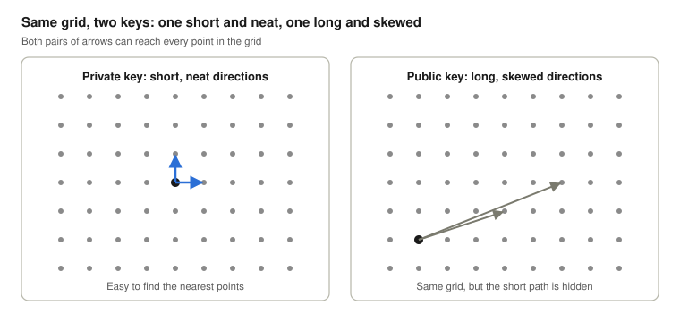

# Lattice Cryptography Without the Heavy Maths

*Effa binte Ashfaq · 22 November 2026*

**The encryption protecting your messages today has a known expiry date. We just don't know the exact day.**

Almost every secure connection you make, from banking apps to software updates, relies on two maths problems: factoring huge numbers (RSA) and discrete logarithms (Diffie-Hellman and elliptic curves). Ordinary computers would need thousands of years to break them. A large enough quantum computer running Shor's algorithm could break them in hours.

That machine does not exist yet. But attackers do not need to wait for it. They can record encrypted traffic now and decrypt it later, once the hardware arrives. Security people call this **harvest now, decrypt later**, and it is why the move to new cryptography has already started.

The leading replacement is built on something called a lattice. This post explains what that is, why it is hard to break, and why picking the right maths is only half the job. It is based on a survey I co-authored with colleagues at Air University, *Lattice-Based Cryptography for Post-Quantum Security*, which reviewed 138 sources on the topic. No equations required.

## So what is a lattice?

Picture an orchard where the trees are planted in perfect rows. Stand at any tree and you can reach every other tree by taking some number of steps in two fixed directions. That repeating pattern of points is a **lattice**, and the two directions are called its **basis**.

Here is the interesting part. The same orchard can be described by many different pairs of directions. One pair might be short and neat, like "one step east, one step north". Another pair might be long and slanted, like "three east and one north" and "five east and two north". Both pairs reach every tree. But only the neat pair makes it obvious where the nearest trees are.

*A lattice and two ways to describe it.*

That difference is the heart of lattice cryptography. The private key is the neat description. The public key is a messy one for the same grid. In two dimensions you can still see the pattern by eye. Real schemes use hundreds of dimensions, where the messy description gives almost nothing away.

## The hard problems, in plain words

Lattice cryptography rests on a few puzzles that nobody, with a normal or a quantum computer, knows how to solve quickly.

**The shortest vector problem.** Given a lattice described by a messy, skewed set of directions, find the point closest to the origin. In two dimensions you can spot it by eye. In 700 or more dimensions, the best known methods take an impractical amount of time. The trick is that the person who made the lattice keeps a neat, short set of directions as their private key, while everyone else only sees a scrambled version of the same grid.

**Learning with errors (LWE).** This is the workhorse behind the new standards, and it is easier to picture than it sounds. Imagine I give you a list of simple equations, but every answer is off by a tiny random amount:

- 3a + 5b = 41 (really 40, nudged by +1)
- 2a + 7b = 44 (really 45, nudged by -1)
- 6a + 1b = 35 (correct, nudged by 0)

Without the noise, school algebra finds the secret (a = 5, b = 5) in seconds. With the noise, and with hundreds of unknowns instead of two, recovering the secret becomes extremely hard. The small errors are the whole point. As our survey puts it, noise is both a security resource and a correctness constraint: too little and attacks get easier, too much and the person with the key can no longer decrypt.

What makes LWE special is a result by Oded Regev in 2005: breaking typical LWE instances is at least as hard as solving the *worst* cases of certain lattice problems. Most cryptography only has evidence that random instances look hard. LWE has a proof that ties it to the hardest version of the puzzle.

**Making it practical.** Plain LWE needs large keys. Two variants fix this. **Ring-LWE** packs the numbers into polynomials, which makes keys smaller and maths faster. **Module-LWE** sits in the middle, keeping much of the efficiency while adding back some safety margin. Module-LWE is the version the new standards chose.

## From maths to standards

In August 2024, after an eight-year public competition, NIST published its first post-quantum standards. Two of the three are lattice-based.

| Standard | Name | Built from | Replaces | What it does |
| --- | --- | --- | --- | --- |
| [FIPS 203](https://csrc.nist.gov/pubs/fips/203/final) | ML-KEM | CRYSTALS-Kyber, Module-LWE | Diffie-Hellman, ECDH, RSA key exchange | Lets two parties agree on a shared secret key |
| [FIPS 204](https://csrc.nist.gov/pubs/fips/204/final) | ML-DSA | CRYSTALS-Dilithium, Module-LWE and Module-SIS | RSA and ECDSA signatures | Proves who signed something and that it was not changed |
| [FIPS 205](https://csrc.nist.gov/pubs/fips/205/final) | SLH-DSA | SPHINCS+, hash functions | Backup signature option | A non-lattice signature, so not every egg is in one basket |

There is a trade-off worth knowing. Lattice keys are bigger than the elliptic curve keys we use today. An X25519 public key is 32 bytes. An ML-KEM-768 public key is 1,184 bytes and its ciphertext is 1,088 bytes, according to FIPS 203. For most web traffic that is fine. For tiny IoT devices or protocols with strict packet sizes, it matters.

Lattices also do more than replace old tools. The same foundations support **fully homomorphic encryption**, which lets a server compute on data without ever decrypting it. Our survey notes, though, that these advanced uses are far less mature than ML-KEM and ML-DSA. Being possible is not the same as being ready.

## The catch: hard maths is not the whole story

This is the main finding of our survey, and the part most introductions skip. **A scheme can be mathematically unbreakable and still leak its secrets in practice.**

Here is why:

- **Side channels.** The time a chip takes, the power it draws or the electromagnetic noise it gives off can reveal the secret key. Researchers have shown timing, power, cache and electromagnetic attacks against real implementations of Kyber and Dilithium, the schemes behind ML-KEM and ML-DSA.
- **Speed tricks create new risks.** Lattice schemes spend most of their time multiplying polynomials, and a technique called the Number Theoretic Transform (NTT) makes that fast. The same optimization changes memory access and timing patterns, which can open new leakage paths.
- **Protection has a cost.** Defences such as masking and constant-time code reduce leakage but add cycles, memory and complexity. On a small embedded device, that cost can be the difference between usable and not.
- **Parameters are a balancing act.** Bigger dimensions mean stronger security but larger keys. More noise means harder attacks but a higher chance that decryption fails. The choices have to be made together.

Our survey sums this up as a three-way tension between security, efficiency and structure. The algebraic structure that makes lattices fast is the same structure that has to be analysed for weaknesses. There is no single best lattice scheme. The right choice depends on the device, the protocol and the threat.

Standardization does not end the work either. FIPS 203 and 204 fix the algorithms, but attacks, implementations and protocol integrations keep evolving. The problem has moved from *which algorithm* to *how do we migrate safely*.

## What this means for you

You do not need to understand lattices to prepare for them. You need to know where your cryptography lives.

1. **Find your crypto.** List where RSA, ECDH and ECDSA are used: TLS, VPNs, certificates, code signing, HSMs, embedded devices.
2. **Start with long-lived secrets.** Data that must stay confidential for ten years or more is the first target of harvest now, decrypt later.
3. **Use hybrid mode during the transition.** Many systems now combine a classical algorithm with ML-KEM, so the connection stays safe even if one of the two fails.
4. **Build crypto-agility.** Design systems so algorithms and parameters can be swapped without a rebuild. This will not be the last migration.
5. **Ask vendors the right questions.** Not just "do you support ML-KEM?" but which library, which parameter set, and what side-channel protection.

## Closing thoughts

Lattice cryptography went from a theoretical idea in the 1990s to a federal standard in 2024. Its strength comes from puzzles that have resisted decades of attack, a rare proof linking typical cases to the hardest ones, and enough efficiency to run on everyday hardware.

But the lesson from our review is simple. **Post-quantum security is a property of the whole system, not a label on an algorithm.** The maths gives us a strong foundation. Careful implementation, testing and migration are what turn it into real protection.

*This post is based on* Lattice-Based Cryptography for Post-Quantum Security: Foundations, Schemes, Attacks, Implementations, Standardization, and Future Directions *by Usman Ghani, Effa binte Ashfaq, Hilmand Khan, Sibgha Tahir and Hira Asmat.*

## Sources

- [NIST FIPS 203: ML-KEM](https://csrc.nist.gov/pubs/fips/203/final)
- [NIST FIPS 204: ML-DSA](https://csrc.nist.gov/pubs/fips/204/final)
- [NIST FIPS 205: SLH-DSA](https://csrc.nist.gov/pubs/fips/205/final)
- [Regev, On lattices, learning with errors, random linear codes, and cryptography (2005)](https://doi.org/10.1145/1060590.1060603)
- [Ravi et al., Side-channel and fault-injection attacks over lattice-based post-quantum schemes (2024)](https://doi.org/10.1145/3603170)
