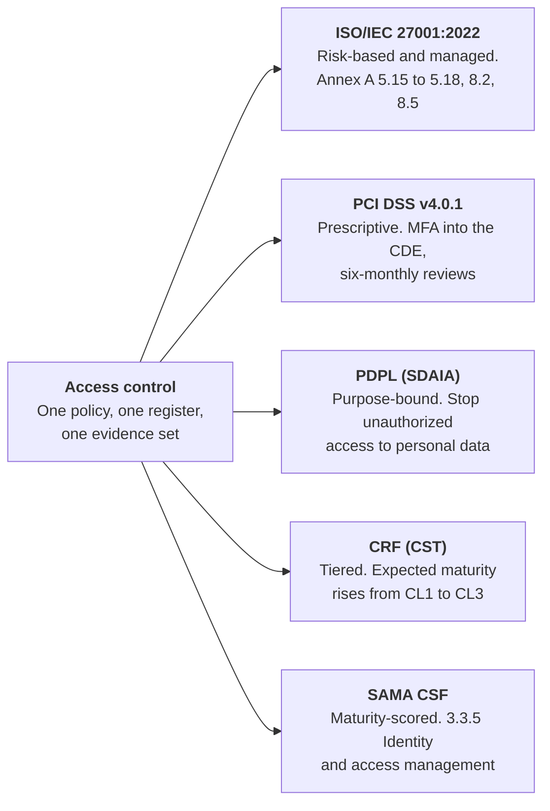

# One Control, Five Frameworks

*Effa binte Ashfaq · 22 November 2026*

**If you build a control well once, you can usually prove it to five frameworks.** The hard part is knowing what each one wants to see.

Many organizations in Saudi Arabia, and the service providers that work with them, do not answer to one framework. A payment company may hold an ISO 27001 certificate, process card data under PCI DSS, handle personal data under the PDPL, be regulated by SAMA, and run ICT services that fall under the CST Cybersecurity Regulatory Framework (CRF). Each comes with its own document, its own language and its own auditor.

The common mistake is treating these as five separate projects. Teams write five access policies, collect five sets of evidence and run five review cycles for what is, in practice, the same control. This post takes one control, access control, and walks through what each framework asks for, where they overlap, and where they genuinely differ.

## Meet the five frameworks

Before comparing controls, it helps to know what kind of document each one is. Two are standards you choose or contract into, two are sector regulations, and one is a law.

| Framework | Issued by | Applies to | What it is |
| --- | --- | --- | --- |
| **ISO/IEC 27001:2022** | ISO / IEC | Any organization that chooses to certify | A risk-based management system standard, with 93 Annex A controls |
| **PCI DSS v4.0.1** | PCI Security Standards Council | Anyone who stores, processes or transmits cardholder data | A prescriptive technical standard, enforced through card brands and acquirers |
| **PDPL** | Saudi Data and AI Authority (SDAIA) | Anyone processing personal data of individuals in Saudi Arabia, including foreign entities | A privacy law with Implementing Regulations |
| **CRF** | Communications, Space and Technology Commission (CST) | CST-licensed ICT and postal service providers | A sector cybersecurity regulation with tiered compliance levels |
| **SAMA CSF** | Saudi Central Bank (SAMA) | Banks, insurers, payment and finance companies regulated by SAMA | A sector cybersecurity framework scored on maturity levels |

A quick note on scope: SAMA states that its framework draws on [NIST, ISF, ISO, BASEL and PCI](https://rulebook.sama.gov.sa/en/entiresection/3850). That shared ancestry is exactly why so much of the mapping below lines up.

## Why access control

Access control is the best control to start with because every one of the five frameworks requires it, and auditors test it in every audit. It is also where duplicated work shows up fastest: the same user list gets exported, reviewed and signed off again and again.

*One control, five frameworks, each with its own lens.*

The hub is the control you build. Each framework on the right reads it through its own lens, which the next two sections unpack.

## Access control, side by side

Here is how each framework expresses the same control. The clause numbers are where an auditor will look first.

| Requirement | ISO 27001:2022 | PCI DSS v4.0.1 | PDPL (KSA) | CRF (CST) | SAMA CSF |
| --- | --- | --- | --- | --- | --- |
| **Access policy** | 5.15 Access control | Req. 7.1 and 8.1: policies and roles defined | Security measures required under the law and its Implementing Regulations | Required within the identity and access management domain | 3.3.5 Identity and access management |
| **Least privilege / need to know** | 5.15, 5.18 | 7.2: access by job function and least privilege | Access only for the stated processing purpose | Required | Core principle of 3.3.5 |
| **Unique user IDs** | 5.16 Identity management | 8.2: no shared IDs without justification | Implied by accountability for processing | Required | Required |
| **Authentication** | 5.17, 8.5 Secure authentication | 8.3 and 8.4: MFA for all access into the cardholder data environment (8.4.2) | Technical measures to prevent unauthorized access | Required, stronger at higher levels | MFA expected for privileged and remote access |
| **Privileged access** | 8.2 Privileged access rights | 7.2 and 8.6: system and application accounts managed | Covered by general security duty | Required | Required, closely examined |
| **Access reviews** | 5.18 Access rights | 7.2.4: user accounts reviewed at least every six months | Part of ongoing security measures | Required | Periodic review required |
| **Joiner, mover, leaver** | 5.18, 6.5 | 8.2.4 to 8.2.6: add, change, remove and disable inactive accounts | Revoke access when no longer needed | Required | Required |

The pattern is clear. Every framework wants a policy, least privilege, unique identities, strong authentication, controlled privileged access and regular reviews. **The core control is identical.** What changes is the scope, the strictness and the evidence.

## Where they differ

The control is shared, but each framework looks at it through a different lens.

- **ISO 27001 asks: is it risk-based and managed?** It does not tell you how often to review access or which systems need MFA. You decide that through your risk assessment, record it in your Statement of Applicability, and prove the management system keeps it working.
- **PCI DSS asks: is it done exactly as written?** It is the most prescriptive of the five. MFA for all access into the cardholder data environment under 8.4.2 became [mandatory after 31 March 2025](https://www.bdo.com/insights/digital/pci-dss-version-4-0-multi-factor-authentication), and reviews have fixed frequencies. Scope is narrow but strict.
- **PDPL asks: is personal data protected from unauthorized access?** The law sets the duty and leaves the method to you. The focus is the data subject, so access must match the purpose of processing. SDAIA [opened a consultation in October 2026](https://www.akingump.com/en/insights/alerts/saudi-data-and-ai-authority-proposes-amendments-to-implementing-regulations-of-the-pdpl-10-key-proposed-changes) on amendments that would apply breach notification to any unauthorized access, which raises the stakes for access control.
- **CRF asks: does it match your compliance level?** CST's framework is [tiered from CL1 to CL3](https://www.secure.com/blog/compliance/cst-crf-compliance-levels-cl1-cl3-guide), so the same control is expected to be more mature for a larger or more critical provider.
- **SAMA asks: how mature is it?** SAMA's principle for identity and access management is that institutions only grant [authorized and sufficient access to approved users](https://www.isdecisions.com/en/compliance/sama-cybersecurity-framework). Assessment is scored on maturity, so a documented but inconsistent process will not score well.

One honest caveat: PDPL and CRF are written as principles and domains rather than numbered access control clauses. Always check your mapping against the current text of each document before an audit.

## Build once, prove five times

The practical approach is to design to the strictest requirement and map outward. For access control, that usually means building to PCI DSS strictness and SAMA maturity, then showing how the same control satisfies the rest.

1. **Write one access control policy.** Cover least privilege, unique IDs, MFA, privileged access, reviews and leavers. Add a short mapping appendix that lists the matching clause in each framework.
2. **Set the bar at the strictest framework.** If PCI DSS asks for six-monthly reviews and MFA into the cardholder data environment, apply that standard to all critical systems, not only the in-scope ones. It is simpler to run one rule than two.
3. **Keep one control in your register.** In your risk register and Statement of Applicability, record access control once, with a column showing each framework it serves.
4. **Collect evidence once, tag it many times.** A quarterly access review export, an MFA configuration screenshot and a leaver ticket sample can each be tagged to all five frameworks.
5. **Add the framework-specific extras on top.** PDPL may need a link between access and processing purpose. SAMA may need maturity evidence such as metrics and trend reports. CRF needs the controls for your assigned level.
6. **Run one review cycle.** Align internal audits so one access review feeds every framework, instead of five teams sampling the same accounts.

## Closing thoughts

Multi-framework compliance feels heavy when every framework is treated as its own project. Once you see that most of them describe the same controls in different words, the work becomes a mapping exercise rather than a rebuild.

Access control is only one example. The same approach works for logging and monitoring, incident response, vendor risk and backup. **Pick the control, find the strictest version, build it once, and map it everywhere it belongs.**

## Sources

- [ISO/IEC 27001:2022](https://www.iso.org/standard/27001) (Annex A controls 5.15 to 5.18, 8.2, 8.5)
- [PCI DSS v4.0 MFA requirements, BDO](https://www.bdo.com/insights/digital/pci-dss-version-4-0-multi-factor-authentication)
- [PCI DSS requirements effective after 31 March 2025, Linford & Co](https://linfordco.com/blog/pci-dss-4-0-requirements-guide/)
- [PDPL overview, Securiti](https://securiti.ai/saudi-arabia-personal-data-protection-law)
- [Proposed PDPL Implementing Regulation amendments, Akin Gump](https://www.akingump.com/en/insights/alerts/saudi-data-and-ai-authority-proposes-amendments-to-implementing-regulations-of-the-pdpl-10-key-proposed-changes)
- [CST Cybersecurity Regulatory Framework](https://www.cst.gov.sa/en/regulations-and-licenses/regulations/Document-413)
- [CST CRF compliance levels, Secure.com](https://www.secure.com/blog/compliance/cst-crf-compliance-levels-cl1-cl3-guide)
- [SAMA Cyber Security Framework rulebook](https://rulebook.sama.gov.sa/en/entiresection/3850)
